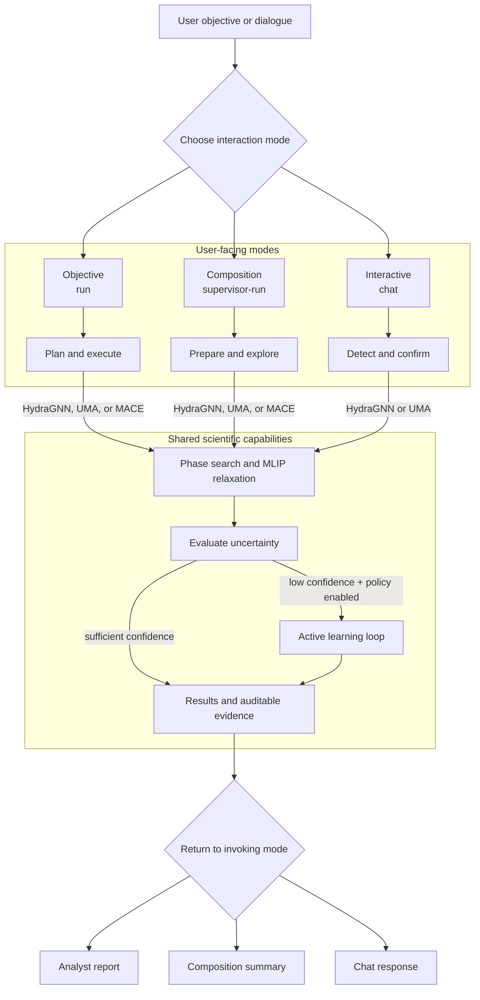

# Package architecture

The library is organized around stable scientific responsibilities rather than
individual experiments or machines.

| Package | Responsibility |
| --- | --- |
| `orchestration` | Typed workflow state, objective/composition graphs, the interactive discovery chat, and explicit policies |
| `orchestration.agents` | Planner, executor, and analyst nodes wired by the objective graph |
| `discovery` | Composition parsing, structure generation, and stability analysis |
| `active_learning` | Candidate acquisition, uncertainty evaluation, labeling, and adaptation loops |
| `training` | Standalone UMA, MACE, and HydraGNN fine-tuning programs and their cost tracking |
| `campaign` | Multi-formula campaign planning, per-formula execution, registry, and review |
| `backends.llm` | Configuration-selected language-model providers |
| `backends.mlip` | MLIP configuration, calculator factories, HydraGNN checkpoint/energy loading, MC dropout, and relaxation |
| `backends.dft` | DFT job contracts, configuration, concurrent dispatch, and Quantum ESPRESSO/VASP interfaces |
| `execution` | Scheduler-neutral resources, launch contracts, provenance, and the backend capability registry |
| `datasets` | Dependency-free dataset governance, elemental reference manifests, formation-energy dataset preparation, energy alignment, and objective-aware train/validation/test splits |
| `workflows` | Composable relaxation, phase-exploration, investigation, and MLIP→DFT warm-start benchmark workflows |

The workflow layer uses `execution.contracts` for evidence, validation,
approval, compute-budget, provenance, status, and result envelopes. Scientific
run directories are owned by `execution.run_directory`; scheduler allocation
discovery and disjoint DFT node grouping are owned by `execution.allocation`.
See [Scientific workflow contracts](scientific-workflows.md) for behavior and
[Run artifacts and restarts](run-artifacts-and-restarts.md) for persistence.

## Import layers

Packages are layered; a package may import only from strictly lower layers.
Packages on the same layer are independent of each other. The order is
enforced by `tests/test_package_boundaries.py`.

| Layer | Packages |
| --- | --- |
| 6 | `cli` |
| 5 | `orchestration`, `campaign` |
| 4 | `active_learning`, `workflows` |
| 3 | `discovery`, `training` |
| 2 | `backends.llm`, `backends.dft`, `backends.mlip` |
| 1 | `execution`, `datasets` |

When new code needs something from a higher layer, move the shared piece down
(usually into `datasets`, `execution`, or the relevant `backends` package)
instead of adding an upward import.

## Orchestration topology

The CLI exposes objective, composition, and interactive modes over shared
scientific capabilities. Each mode can hand low-confidence work to the same
active-learning implementation when its UQ policy permits it. The full diagram
is maintained in [Agentic AI Workflow Diagram](workflows/agentic-ai-workflow.md),
with a compact variant in
[Agentic AI Workflow Slides](workflows/agentic-ai-workflow-slides.md).

Machine-specific setup and job scripts live in `deployments/`; research-only
paper and Codabench artifacts live in `research/`.

## Five stable interfaces

Each backend boundary is defined by a `@runtime_checkable` Protocol so that
new implementations only need to satisfy the structural contract — no
inheritance required.

| Interface | Import path | Key methods / attributes |
| --- | --- | --- |
| `DFTBackend` | `matsim_agents.backends.dft` | `name`, `run_one(spec) → DFTResult` |
| `MLIPBackend` | `matsim_agents.backends.mlip` | `name`, `as_calculator() → Calculator`, `relax(atoms, *, fmax, max_steps) → RelaxationResult` |
| `LLMBackend` | `matsim_agents.backends.llm` | type alias for `langchain_core.language_models.BaseChatModel` |
| `ExecutionPlatform` | `matsim_agents.execution` | `name`, `submit(cmd, *, resources, workdir) → str`, `available_resources() → ResourceRequest` |
| `RunStore` | `matsim_agents.execution` | `append(record) → None`, `iter_records() → Iterable` |

These backend Protocols are extension boundaries. The newer scientific
workflow models are policy and result contracts layered above them, not
replacement backend interfaces.

`JsonlRunStore` in `matsim_agents.execution.provenance` is the concrete
`RunStore` implementation backed by a newline-delimited JSON file.

## Compatibility policy

Each module has exactly one import path. The former aliases
(`matsim_agents.graph`, `matsim_agents.state`, `matsim_agents.llm`,
`matsim_agents.supervisor`, the `matsim_agents.tools` package, the top-level
`matsim_agents.agents` package (now `matsim_agents.orchestration.agents`),
`matsim_agents.chat` (now `matsim_agents.orchestration.interactive_chat`),
and `matsim_agents.active_learning.backends`) have been removed; import from the
canonical packages listed above.
