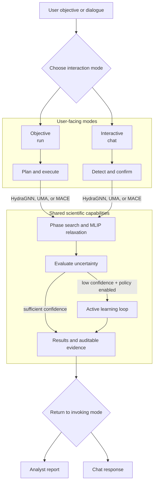

# Package architecture

This page is for contributors: it maps Python packages to their responsibilities.
For the agent graphs, workflows, and current capabilities, see
[Architecture and capabilities](guide/architecture.md).

`src/matsim_agents` is a general framework. It holds no campaign, material
system or facility constants. Scientific campaigns are applications in
[examples/](../examples/README.md): an `application.yaml` read with
`matsim_agents.core.application.load_application`. Benchmarks live in
`benchmarks/`, machine job scripts in `deployments/`, frozen research
artifacts in `research/`.

| Package | Responsibility |
| --- | --- |
| `core` | Dependency-free contracts: application schema, composition, seeding, hashing, energy conventions, relaxation results, numerical stress |
| `execution` | Scheduler-neutral resources, launch contracts, provenance, run directories, allocation, budgets and the capability registry |
| `data` | Dataset governance, energy alignment, formation-energy training data and objective-aware splits |
| `backends.llm` | Configuration-selected language-model providers |
| `backends.dft` | DFT job contracts, concurrent dispatch, Quantum ESPRESSO and VASP |
| `backends.mlip` | MLIP configuration, calculator factories, HydraGNN, MC dropout, relaxation and fine-tuning |
| `backends.mcp` | Optional Model Context Protocol client with deny-by-default authorization ([MCP tools](mcp.md)) |
| `science` | Backend-free physics: structures, thermodynamics, defects, NEB, kinetics, irradiation, magnetism, properties, acquisition and decision scoring |
| `backends.external` | Adapters for external codes that consume science contracts, e.g. SPECTRA-PKA |
| `workflows` | Composable relaxation, exploration, active learning, hierarchy, full-supercell, radiation, debate and evaluation workflows |
| `agents` | Objective graph, role agents and interactive chat |
| `cli` | The `matsim-agents` command; generic commands only |

The workflow layer uses `execution.contracts` for evidence, validation,
approval, compute-budget, provenance, status, and result envelopes. Scientific
run directories are owned by `execution.run_directory`; scheduler allocation
discovery and disjoint DFT node grouping are owned by `execution.allocation`.
See [Scientific workflow contracts](scientific-workflows.md) for behavior and
[Run artifacts and restarts](run-artifacts-and-restarts.md) for persistence.

## Config-driven exploration: where to start reading

The CLI and Python API use a single checkpointed engine for any number of rounds.
Read the modules in this order:

| Module | Responsibility |
| --- | --- |
| [`cli/exploration.py`](../src/matsim_agents/cli/exploration.py) | Parse commands and present progress, errors, and summaries |
| [`workflows/exploration/api.py`](../src/matsim_agents/workflows/exploration/api.py) | Small public API: check, run, summarize, resume |
| [`workflows/exploration/config.py`](../src/matsim_agents/workflows/exploration/config.py) | Validate settings, resolve paths, preflight dependencies/checkpoint, build relaxation requests |
| [`workflows/exploration/rounds.py`](../src/matsim_agents/workflows/exploration/rounds.py) | Execution lifecycle: lock, generate, checkpoint, relax, rank, finish |
| [`workflows/exploration/checkpoint.py`](../src/matsim_agents/workflows/exploration/checkpoint.py) | Journal contracts, progress invariants, artifact hashes, runtime compatibility |
| [`workflows/exploration/reporting.py`](../src/matsim_agents/workflows/exploration/reporting.py) | Read-only summaries and cumulative relative-energy reports |
| [`science/structures/screening.py`](../src/matsim_agents/science/structures/screening.py) | Structural equivalence and deterministic diversity selection |

New scientific options belong in the validated configuration and its shared
request builder, not duplicated single-/multi-round execution paths.
Checkpoint preparation is transactional: candidates/attempts become committed
only when the journal is atomically written; interruption restores the last
committed state before saving the error. Reporting does not resume or calculate.
Native exploration uses the shared atomic-file `exclusive_lock` with immediate
contention failure, rather than `flock`, which is unsupported on NERSC CFS
compute nodes. The lock covers generation, attempts, and final reporting and is
released on interruption; competing writers are still rejected.

Only version-3 exploration checkpoints are supported; there is no legacy reader
or migration layer. The separate advanced phase-exploration/active-learning
workflow retains its own contracts and is not invoked by this config-driven API.

## Common advanced-workflow interface

[`workflows.runner`](../src/matsim_agents/workflows/runner.py) is the one entry
point for config-driven runs: it detects a config's kind, preflights it without
compute (`validate`), executes it (`run`) and continues it (`resume`). It calls
the native workflows in-process, not a second scientific engine.
[`workflows.run_records`](../src/matsim_agents/workflows/run_records.py) persists
every invocation, including blocked and failed ones, as `run-record.json` plus a
readable `report.md` using atomic run-directory storage. The CLI commands in
[`cli/runs.py`](../src/matsim_agents/cli/runs.py) are thin wrappers over this API.
Scientific checkpoints/results remain owned by their native engines.

User-facing guides separate [running tasks](workflows/run-campaigns.md),
[interpreting results](workflows/interpret-results.md), and
[extending the library](workflows/extend-library.md).

## Import layers

Packages are layered; a package may import only from strictly lower layers.
Packages on the same layer are independent of each other. The order is
enforced by `tests/test_package_boundaries.py`.

| Layer | Packages |
| --- | --- |
| 8 | `cli` |
| 7 | `agents` |
| 6 | `workflows` |
| 5 | `backends.external` |
| 4 | `science` |
| 3 | `backends.llm`, `backends.dft`, `backends.mlip`, `backends.mcp` |
| 2 | `execution`, `data` |
| 1 | `core` |

`tests/test_package_boundaries.py` also checks that:

- `science` imports no backend;
- the framework imports nothing from `examples/`, `benchmarks/` or `research/`;
- `src/` holds no campaign or facility literals (compositions such as
  `W640...`, project ids, site paths);
- module and CLI command names are campaign-neutral;
- removed modules stay removed.

CI runs these checks, and dry-runs every application, in the `architecture` job of `.github/workflows/ci.yml`.

When new code needs something from a higher layer, move the shared piece down
(usually into `core`, `data`, `execution`, or the relevant `backends` package)
instead of adding an upward import.

## Orchestration topology

The CLI exposes objective and interactive modes over shared
scientific capabilities. Each mode can hand low-confidence work to the same
active-learning implementation when its UQ policy permits it. The full diagram
is maintained in [Agentic AI Workflow Diagram](workflows/agentic-ai-workflow.md),
with a compact variant in
[Agentic AI Workflow Slides](workflows/agentic-ai-workflow-slides.md).

## Five stable interfaces

Each backend boundary is defined by a `@runtime_checkable` Protocol so that
new implementations only need to satisfy the structural contract — no
inheritance required.

| Interface | Import path | Key methods / attributes |
| --- | --- | --- |
| `DFTBackend` | `matsim_agents.backends.dft` | `name`, `run_one(spec) → DFTResult` |
| `MLIPBackend` | `matsim_agents.backends.mlip` | `name`, `as_calculator() → Calculator`, `relax(atoms, *, fmax, max_steps) → RelaxationResult` |
| `LLMBackend` | `matsim_agents.backends.llm` | type alias for `langchain_core.language_models.BaseChatModel` |
| `ExecutionPlatform` | `matsim_agents.execution` | `name`, `submit(cmd, *, resources, workdir) → str`, `available_resources() → ResourceRequest` |
| `RunStore` | `matsim_agents.execution` | `append(record) → None`, `iter_records() → Iterable` |

These backend Protocols are extension boundaries. The newer scientific
workflow models are policy and result contracts layered above them, not
replacement backend interfaces.

`JsonlRunStore` in `matsim_agents.execution.provenance` is the concrete
`RunStore` implementation backed by a newline-delimited JSON file.

## Compatibility policy

Each module has exactly one import path; there are no aliases, wrappers or
deprecated commands. Removed modules, including the former campaign, fusion,
supervisor and E1/E3 packages, are listed in `tests/test_package_boundaries.py`
and must not return. Campaign code belongs in an application under `examples/`
or in `benchmarks/`.
