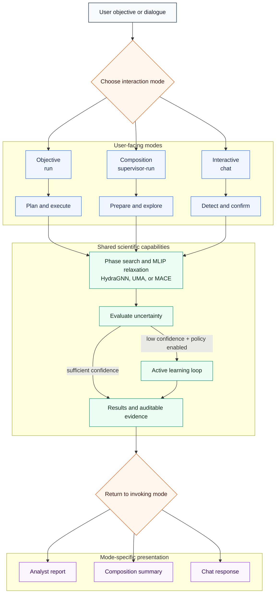

# Architecture and capabilities

This page describes the agent graphs, workflows, and what is available today.
For the Python package layout, see [package architecture](../architecture.md).

## Architecture

Reusable standalone workflow graphics:
- [docs/workflows/agentic-ai-workflow.md](../workflows/agentic-ai-workflow.md)
- [docs/workflows/agentic-ai-workflow-slides.md](../workflows/agentic-ai-workflow-slides.md)

```
                ┌──────────────────────────────────────────────┐
                │                  USER                        │
                │  natural-language objective / chat dialogue  │
                └───────────────────────┬──────────────────────┘
                                        │
                ┌───────────────────────▼──────────────────────┐
                │         LangGraph orchestration layer         │
                │                                               │
                │  (A) run: planner -> executor -> uq_gate      │
                │      -> [optional AL handoff] -> analyst      │
                │  (B) supervisor-run: prepare -> explore       │
                │      -> evaluate_uq -> [optional AL handoff]  │
                │      -> summarize                              │
                └───────────────────────┬──────────────────────┘
                                        │  tool calls
                ┌───────────────────────▼──────────────────────┐
                │              Discovery wrapper               │
                │   composition parsing → phase enumeration    │
                │   → relaxation (selected MLIP+ASE) → stability│
                └───────────────────────┬──────────────────────┘
                                        │
                ┌───────────────────────▼──────────────────────┐
                │             Atomistic backends               │
                │   HydraGNN (fused or selected decoder head)  │
                │   UMA + open MACE foundation-model families │
                │   ASE (FIRE / BFGS / BFGSLineSearch)         │
                │   pymatgen (AFLOW prototype encyclopedia)    │
                │   pyXtal (random symmetry-aware search)      │
                └──────────────────────────────────────────────┘
```



### Capabilities

- **Multi-agent orchestration** with LangGraph: typed shared state, checkpointed steps, conditional routing, human-in-the-loop gates.
- **Hypothesis-generation chat** with any local LLM (Qwen 2.5 via Ollama by default).
- **LLM-only chat** (`matsim-agents chat --llm-only`) that requires no MLIP
  configuration or atomistic environment and disables `/relax`, `/al`, and
  automatic composition exploration. The system prompt explicitly declares
  those capability limits, even with custom prompts and after `/clear`.
- **Optional multi-LLM hypothesis debate in chat**: a proposer model drafts a
  hypothesis response, a critic model challenges weak assumptions and missing
  tests, and the proposer revises for one or more rounds (`--llm-peer-review`,
  `--critic-llm-*`, `--peer-review-rounds`).
- **Automatic composition detection** in user/LLM messages — when a new chemical formula is proposed, the system offers to run a substantial atomistic exploration.
- **Slash commands inside discovery chat**: `/relax <structure_path>` (single-structure relaxation), `/al [composition]` (trigger an active-learning handoff for the given or most recently discussed composition), and `/clear` (reset the conversation and discovery state).
- **Discovery-to-active-learning escalation policy**: when branch-weight UQ indicates low confidence, discovery can hand off to AL automatically from the same run.
- **Structured handoff audit artifacts**: JSONL records of UQ metrics, thresholds, trigger rationale, and action (`not_triggered`, `triggered_dry_run`, `triggered_run`).
- **Selectable surrogate backend for geometry relaxation**:
  - **HydraGNN** fused MLFF + branch-weight MLP stack (default), or one
    explicitly selected decoder head for dataset-specific inference.
  - **UMA** (Universal Models for Atoms) via fairchem (`backend: uma`).
  - **MACE** open foundation-model families and user checkpoints
    (`backend: mace`), isolated from UMA in multi-model validation.
  - Every command selects the backend with `--mlip-config FILE`, a YAML whose
    `mlip:` block holds `backend` and that backend's settings (see
    `examples/mlip/`).
  - Note: branch-weight UQ is specific to fused HydraGNN inference. Pinned-head
    HydraGNN supports MC-dropout UQ but does not report branch weights; UMA and
    MACE relaxations do not emit branch-weight metrics.
- **Unified crystal-phase seed generation** (`matsim_agents.discovery.seeds`)
  combining two complementary sources into one ranked candidate list:
  - **AFLOW prototype decoration** — every entry of the
    pymatgen-bundled AFLOW encyclopedia (~288 prototypes covering all
    230 3-D space groups and a wide range of stoichiometries: fcc, bcc,
    hcp, rocksalt, zincblende, wurtzite, fluorite, rutile, perovskite,
    spinel, Heusler, MAX phases, …) whose reduced stoichiometric ratios
    match the target is decorated with the target's elements. All
    symmetrically distinct element-to-Wyckoff assignments are
    enumerated (e.g. ABX₃ *vs* BAX₃). No hand-coded prototype tables.
  - **pyXtal random search** (`--n-random N`, novelty pass) — for
    compositions with no AFLOW match (high-entropy alloys, exotic
    stoichiometries) or simply for novelty exploration, targets up to `N`
    unique crystals while sampling the 230 space groups uniformly, respecting
    Wyckoff multiplicities and minimum-distance constraints. Failed attempts
    and deduplication can yield fewer than `N` seeds. Seeds
    from this path are tagged `needs_dft_verification=True` and called
    out as `(novel)` in the stability report so they get DFT-validated
    before any publication claim. pyXtal is a core dependency (installed
    by default); the pipeline still degrades gracefully to
    prototypes-only should it ever be absent.
- **Stability scoring**: relative chemical stability (ΔE/atom rankings) and a dynamical-stability proxy (residual force tolerance).
- **Local & HPC ready, portable across diverse DOE accelerators**: same
  Python entry points run on **Frontier (OLCF, AMD MI250X)**, **Aurora
  (ALCF, Intel PVC)**, and **Perlmutter (NERSC, NVIDIA A100)**, plus
  Andes and laptops. The setup script delegates to HydraGNN's
  installers and auto-relaxes HydraGNN's overly-tight `click==8.0.0` /
  `tqdm==4.67.1` pins so the env is conflict-free on every site.
- **First-class DFT labellers built per platform**: validated
  build/run recipes for both **VASP 6.6** (Frontier MI250X, Aurora PVC)
  and **Quantum ESPRESSO `pw.x` GPU** (Frontier MI250X via OpenMP
  target offload, Aurora PVC via `oneapi`/`openmp`, Perlmutter A100 via
  CUDA). Build scripts and SLURM/PBS launchers are checked in for each
  site — see [Portability across DOE supercomputers](hpc.md#portability-across-doe-supercomputers).
- **Pluggable LLMs**: Ollama, vLLM, MAG, Copilot, OpenAI, Anthropic, and
  Hugging Face via a single factory; MAG and Copilot require an explicit model.
- **Active-learning loop** (`matsim-agents al run`): MLIP-driven MD
  generates candidates → ensemble / MC-dropout uncertainty selects the
  most informative → a DFT backend (**VASP 6.6** *or* **Quantum
  ESPRESSO `pw.x`**) labels them in parallel inside one SLURM
  allocation → validated labels grow the dataset. Optional training creates a
  candidate model; only separately approved promotion lets it drive the next
  iteration. The
  DFT backend is a single YAML toggle (`dft.backend: vasp | qe`); both
  share an INCAR-style template path (`INCAR.template` / `pw.template`).
- **LLM-generated MD seeds** (`md.seed_source.kind: prompt`): the LLM
  proposes plausible chemical compositions for a target objective and
  the loop materialises seed structures from common crystal prototypes,
  no curated POSCAR collection required.
- **Templated YAML configs**: `${VAR}`, `${VAR:-default}`, `${VAR:?msg}`
  shell-style substitution with optional in-file `vars:` block, so the
  same config can be re-targeted across users / scratch dirs / runs
  without editing it.
- **Two complementary graph entry points**:
  - `matsim-agents run` for planner-executor-analyst task execution.
  - `matsim-agents supervisor-run` for discovery exploration + UQ-based decisioning + optional AL handoff.
- **Surrogate backend switch for AL/supervisor flows**: an AL config's `mlip`
  block selects its model; `--mlip-config` replaces it at run time, so one
  config runs with any backend:
  - `matsim-agents al run <config.yaml>` (the config's own model)
  - `matsim-agents al run <config.yaml> --mlip-config examples/mlip/uma-s-1p1-omat.yaml` (frozen UMA)
  - `matsim-agents supervisor-run <composition> --mlip-config examples/mlip/uma-s-1p1-omat.yaml ...` (UMA in supervisor path)

## Graph orchestration modes

The repository currently exposes two LangGraph workflows that share the
same numerical kernels (discovery wrapper, relaxations, AL loop):

- **Core agent graph** (`matsim-agents run`): planner -> executor -> uq_gate -> analyst,
  with optional run-path AL handoff when UQ policy is triggered.
- **Supervisor graph** (`matsim-agents supervisor-run`):
  prepare composition -> explore composition -> evaluate UQ -> optional
  active-learning handoff -> summarize.

This split keeps decision logic agentic while preserving deterministic,
restart-friendly HPC kernels for heavy computation.

### Core agent graph

Four nodes share a typed `MatSimState`:

- **planner** — turns the objective into a list of `TaskSpec` items
  (kinds: `relax`, `analyze`, `report`, `mcp_tool`, `mcp_resource`). Uses the LLM with structured
  output; falls back to a deterministic plan when the LLM is unavailable.
- **executor** — pops the next task and runs an MLIP relaxation or an
  authorized external MCP tool/resource request. It appends the corresponding
  result to state and increments `iteration`; `analyze` and `report` tasks
  currently require an MLIP selection and are then skipped without incrementing
  `iteration`. It loops until the queue drains or `max_iterations`
  is reached. See the [MCP guide](../mcp.md).
- **uq_gate** — aggregates branch-weight confidence over relaxation
  results and applies policy thresholds. If low-confidence criteria are
  met and handoff is enabled, this node can launch active learning
  (`--al-config`, `--al-dry-run/--al-run`) and append structured handoff
  events to the state.
- **analyst** — summarizes the accumulated results into a human-readable
  report (LLM-assisted when available, deterministic baseline otherwise),
  including handoff decisions/events when present.

State is checkpointed via LangGraph's `MemorySaver`, so every node
transition is replayable and inspectable.

---

## Current capabilities and planned work

This section spells out what the framework does *today* and what is on
the roadmap but **not yet implemented**, so users know what to expect
before building a workflow on top of it.

### Available today

- **Single-point energies and forces** from any supported MLIP (HydraGNN,
  UMA, or MACE, selected by an `mlip:` block) through an ASE calculator
  interface.
- **Geometry relaxation** of atoms and (optionally) cell with the selected
  MLIP.
- **Isotropic lattice scans** to locate equilibrium volume / lattice
  constant.
- **Random-shuffle ordering enumeration** for disordered sites,
  deduplicated with pymatgen's `StructureMatcher`.
- **AA-stacked 2-D multilayer** construction.
- **Relative chemical-stability scoring** (energy-above-hull style
  comparisons within the explored phase set).
- **LLM-driven planner / executor / analyst** agents (LangGraph). The graphs
  run without pausing for review; human control is exercised through the chat
  confirmation prompt and explicit approvals for DFT execution and model
  promotion.
- **Pluggable LLM backends**: Ollama, vLLM, MAG, Copilot, OpenAI, Anthropic,
  and Hugging Face Transformers (see [LLM backends](llm-backends.md)).
- **Active-learning loop** with HydraGNN, UMA, or MACE as the surrogate and either
  VASP 6.6 or Quantum ESPRESSO `pw.x` as the DFT labeller, selectable
  via a single `dft.backend:` YAML field. Includes ensemble /
  MC-dropout uncertainty scoring, in-allocation parallel DFT dispatch,
  templated INCAR / `pw.in` inputs, and shell-style `${VAR}` /
  `${VAR:-default}` substitution in all YAML configs.
- **LLM-generated MD seeds** as a first-class seed source
  (`md.seed_source.kind: prompt`).
- **Formation-energy reference sets and competing-phase hulls** using
  declared, method-compatible references; incomplete sets produce provisional
  results. Completeness checks do not establish scientific completeness or
  validate the chosen references. See [reference hulls](../reference-hulls.md).

### Not yet implemented (roadmap)

- [ ] **Phonon-based dynamical stability** (phonopy / finite differences).
- [ ] **Additional phase-enumeration sources** beyond the pymatgen AFLOW
      prototypes and pyXtal, such as CALYPSO / USPEX hooks.
- [ ] **Symmetry-aware ordering enumeration** via `enumlib` (today's
      enumerator is random-shuffle + `StructureMatcher` dedup).
- [ ] **Anisotropic / per-axis lattice scans** (today's scan is
      isotropic only).
- [ ] **AB / AA' stacking** for 2-D multilayers (today's builder is
      AA-stacked only).
- [ ] **2-D heterostructures** (e.g. graphene/h-BN, MoS₂/WSe₂) with
      lattice-mismatch search.
- [ ] **MD agent**: NVT/NPT runs driven by the agents with the selected MLIP
      calculator (active learning already runs MLIP MD).
- [ ] **MCP tool server** so external clients (Claude Desktop, IDE
      agents) can call the discovery wrapper directly.
- [ ] **Distributed executor** for parallel composition exploration on
      HPC.
- [ ] **Additional MLFF backends** such as NequIP and Orb behind the same
      calculator interface.

---
