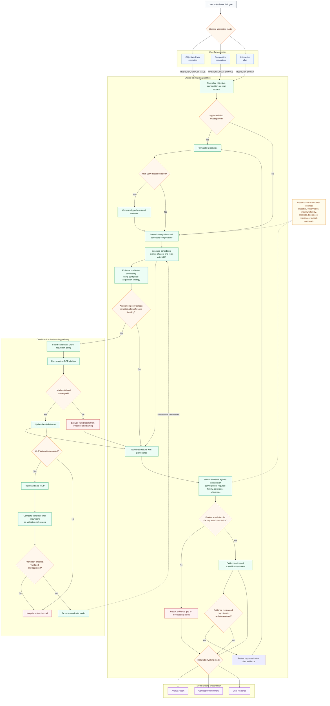

# Agentic AI Workflow Diagram

This page provides a reusable, standalone diagram for presentations, wiki pages, and architecture notes.

Slide-friendly compact variant: [agentic-ai-workflow-slides.md](agentic-ai-workflow-slides.md)

## Notes

- Objective, composition, and interactive modes are user-facing adapters, not
  separate scientific workflows. They share discovery, relaxation, and
  active-learning capabilities when configured, then format results for their
  invoking mode. Objective and composition workflows support HydraGNN, UMA, and
  MACE; interactive chat currently supports HydraGNN and UMA.
- Hypothesis formulation, multi-LLM debate, evidence review, and revision are
  conditional investigation or campaign capabilities, not steps in every run.
- A characterization contract applies to the characterization pathway; it is
  not a prerequisite for every mode or calculation. Evidence requirements
  depend on the requested observable and claim.
- Predictive uncertainty and acquisition rank candidates for possible reference
  calculations. They do not establish that evidence is sufficient for a
  scientific conclusion. Sufficiency depends on the requested claim, including
  convergence, fidelity, coverage, and compatible references where required.
- Active learning can add selectively DFT-labeled structures to a dataset
  without retraining. Adaptation and model promotion are separate opt-ins;
  promotion additionally requires candidate validation and approval. A
  promoted model may be used in subsequent MLIP calculations.
- Failed or unconverged calculations are excluded as positive scientific
  evidence. Evidence-ledger recording is available in campaign and
  characterization workflows, not imposed on every standalone workflow.
- UQ handoff policy is exposed through mode-specific adapters today; the
  diagram groups those adapters by their common responsibility. Fused
  HydraGNN branch weights can drive that policy directly, while pinned-head
  HydraGNN can use MC-dropout when configured. UMA and MACE do not emit
  HydraGNN branch weights, so this specific handoff signal needs an alternative.
- Active-learning acquisition strategies include ensemble disagreement,
  MC-dropout, random selection, and ensemble-then-dropout, depending on backend
  configuration.
- Interactive conversation-only turns return directly to chat, while `/al`
  invokes active learning directly; those shortcuts are omitted above to keep
  the primary scientific workflow legible.
- UQ policy thresholds are configurable from CLI flags (`--uq-top-weight-threshold`, `--uq-min-unreliable-fraction`, and related handoff options).
- Handoff decisions are auditable via JSONL artifacts when `--al-handoff-audit-path` is set (or through default audit paths).
